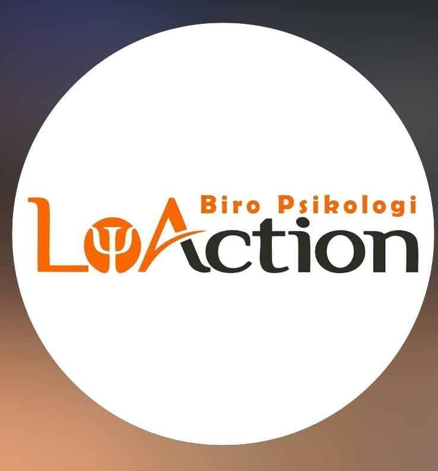
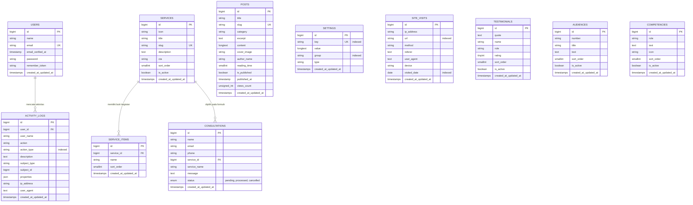

# LoAction — Biro Psikologi Terapan & Uji Kompetensi SDM

<p align="center">
  
</p>

<p align="center">
  <strong>Platform Web Company Profile, Sistem Manajemen Konten (CMS), CRM Konsultasi, dan Layanan Psikologi Terpadu</strong>
</p>

<p align="center">
  <a href="https://loaction.buildsys.site"></a>
  
  
  
  
  
</p>

---

## 📌 Daftar Isi

1. [Tentang LoAction](#-tentang-loaction)
2. [Fitur Utama](#-fitur-utama)
   - [Website Publik (Frontend)](#1-website-publik-frontend)
   - [Admin Panel & CMS Terpusat](#2-admin-panel--cms-terpusat-admin)
3. [Arsitektur & Tech Stack](#-arsitektur--tech-stack)
4. [Struktur Direktori](#-struktur-direktori)
5. [Struktur & Skema Basis Data](#-struktur--skema-basis-data-database-schema)
   - [Entity Relationship Diagram (ERD)](#entity-relationship-diagram-erd)
   - [Daftar Tabel & Spesifikasi Kolom](#daftar-tabel--spesifikasi-kolom)
6. [Panduan Instalasi Lokal](#-panduan-instalasi-lokal)
7. [Kredensial Default Admin](#-kredensial-default-admin)
8. [Panduan Penggunaan Fitur CMS](#-panduan-penggunaan-fitur-cms)
   - [Multi-Nomor WhatsApp](#a-pengelolaan-multi-nomor-whatsapp)
   - [Manajemen CRM Konsultasi](#b-crm-permohonan-konsultasi)
   - [Manajemen Artikel & Edukasi](#c-manajemen-artikel--publikasi)
   - [Audit Trail & Log Sistem](#d-audit-trail--system-logs)
9. [Panduan Deployment ke Server Produksi](#-panduan-deployment-ke-server-produksi)
10. [Keamanan & Optimasi Kinerja](#-keamanan--optimasi-kinerja)
11. [Lisensi & Legalitas](#-lisensi--legalitas)

---

## 🏢 Tentang LoAction

**LoAction** (PT LoAction Solusi Insani) adalah biro psikologi terapan profesional yang berfokus pada 4 pilar utama layanan:
1. **Personal Care:** Konseling individual, terapi klinis, *stress & burnout management*, pengembangan pribadi.
2. **Pendidikan:** Tes penjurusan bakat minat, kesiapan masuk sekolah dasar, asesmen gaya belajar, konsultasi guru & orang tua.
3. **Industri & Organisasi (PIM):** Rekrutmen & seleksi talenta, asesmen promosi jabatan (*Assessment Center*), evaluasi budaya kerja, *team building*.
4. **Uji Kompetensi SDM:** Bimbingan teknis persiapan sertifikasi profesi berbasis SKKNI dan uji kompetensi resmi berlisensi BNSP.

Aplikasi web ini dibangun untuk mempermudah klien menjadwalkan konsultasi, mengeksplorasi layanan, membaca materi edukasi kesehatan mental, serta memudahkan manajemen internal dalam mengelola seluruh konten dan permohonan konsultasi melalui **Admin CMS modern yang 100% responsif**.

---

## 🚀 Fitur Utama

### 1. Website Publik (Frontend)

* **Beranda Dinamis:**
  - Hero section dengan headline, CTA cepat, dan value proposition.
  - Ringkasan profil biro & keunggulan bersertifikasi HIMPSI / BNSP.
  - Kartu pilar layanan utama dengan accordion butir kegiatan.
  - Portofolio skema sertifikasi uji kompetensi dan target audiens.
  - Ulasan/testimoni klien kredibel dengan rating bintang.
* **Halaman Khusus Layanan (`/layanan`):**
  - Eksplorasi detail masing-masing pilar layanan dan langkah alur konsultasi.
* **Halaman Profil Biro (`/profil`):**
  - Visi, misi, nilai luhur biro (*Handle with Care*), legalitas hukum Kemenkumham, dan susunan tim psikolog profesional.
* **Portal Artikel & Edukasi Kesehatan Mental (`/artikel`):**
  - Publikasi artikel psikologi dengan filter kategori interaktif (*Pendidikan, Industri, Personal Care, Uji Kompetensi*).
  - Kolom pencarian topik instan (*search query*).
  - Tampilan artikel lengkap dengan cover foto, estimasi waktu baca, tombol *share* ke WhatsApp, Facebook, LinkedIn, Twitter/X, dan artikel rekomendasi terkait (*Related Posts*).
* **Formulir Konsultasi Online (`/kontak`):**
  - Form permohonan konsultasi terstruktur (nama, kontak, layanan, jenis sesi daring/tatap muka, preferensi jadwal waktu, pesan keluhan).
  - Perlindungan anti-spam dengan **Rate Limiting (5 submit / menit)** dan validasi input menyeluruh.
  - Penyimpanan otomatis ke basis data leads CRM admin.
* **Fitur Multi-Nomor WhatsApp Interaktif:**
  - Tombol *floating WhatsApp* mengambang di pojok kanan bawah.
  - **Single Number:** Mengarahkan langsung ke WhatsApp CS utama.
  - **Multi Number:** Otomatis memicu **Pop-up Selektor WhatsApp CS** yang memungkinkan pengunjung memilih narahubung spesifik (misal: *CS Konsultasi & Jadwal*, *CS Kemitraan & Uji Kompetensi BNSP*).
* **SEO & Webmaster Terintegrasi:**
  - Otomatis menghasilkan `meta description`, `meta keywords`, OpenGraph tags untuk preview media sosial.
  - Peta situs XML otomatis di `/sitemap.xml` yang selalu terbarui.
  - File panduan crawler mesin pencari di `/robots.txt`.
  - Integrasi pengukuran Google Analytics 4 (GA4).
* **Visitor Tracking Otomatis:**
  - Middleware otomatis merekam trafik pengunjung unik, IP, user-agent perangkat, referer, dan counter kunjungan berkala.

---

### 2. Admin Panel & CMS Terpusat (`/admin`)

* **Autentikasi Aman:**
  - Login khusus admin dengan proteksi session token, CSRF token, dan opsi *Remember Me*.
* **Dashboard Analytics:**
  - Ringkasan kartu statistik: Total Pengunjung Unik, Permohonan Konsultasi Baru, Total Artikel Terpublikasi, dan Master Layanan Aktif.
  - Grafik tren kunjungan mingguan dan grafik status permohonan konsultasi.
* **CRM Leads Formulir Masuk (`/admin/consultations`):**
  - Tabel interaktif dengan filter status (*Baru, Dihubungi, Terjadwal, Selesai, Dibatalkan*).
  - Tampilan mobile transformatif: otomatis beralih menjadi format **Card View** yang nyaman di layar ponsel.
  - Aksi instan: **Hubungi via WhatsApp** langsung membuka format template chat terpersonalisasi nama klien.
  - Halaman detail konsultasi untuk menambahkan catatan internal tindak lanjut psikolog.
  - Fitur **Export Data ke CSV/Excel** untuk laporan rekap bulanan.
* **Manajemen Artikel & Berita (`/admin/posts`):**
  - Form pembuatan artikel dengan unggah foto cover, pemilihan kategori, auto-generate slug SEO, ringkasan, dan status (*Draft / Published*).
* **Master Data Management:**
  - **Layanan (`/admin/services`):** Tambah, ubah urutan (*sort order*), ikon, dan kelola butir-butir sub-layanan.
  - **Audiens (`/admin/audiences`):** Target pengguna layanan (Individu, Mahasiswa, Korporat, Sekolah).
  - **Uji Kompetensi (`/admin/competencies`):** Skema unit uji sertifikasi BNSP.
  - **Testimoni (`/admin/testimonials`):** Kelola testimoni klien, nama, institusi, dan jumlah bintang kepuasan.
* **CMS Settings Terpusat (`/admin/settings`):**
  - **Tab 1: Kontak & WhatsApp:** Repeater multi-nomor WA dinamis (+ Tambah Nomor WA, hapus, label, live preview URL, tombol salin tautan), email resmi, telepon kantor.
  - **Tab 2: Lokasi & Sosial Media:** Alamat kantor, jam operasional, link Google Maps embed/share, akun Instagram.
  - **Tab 3: Branding & Beranda:** Nama situs, tagline biro, nomor izin legalitas SK Kemenkumham, judul hero, sub-judul, dan kutipan profil.
  - **Tab 4: SEO & Webmaster:** Meta description counter (rekomendasi 160 karakter), meta keywords, dan ID Google Analytics 4.
* **Log Center & Audit Trail (`/admin/logs`):**
  - **Tab Aktivitas Admin:** Riwayat audit setiap aksi pembuatan/perubahan data master dan pengaturan CMS.
  - **Tab Log Sistem:** Pembaca file log Laravel langsung dari browser dengan pemilahan level (*ERROR, WARNING, INFO*), dan tombol *Clear Log*.
  - **Tab Log Kunjungan:** Rekam jejak pengunjung publik secara real-time.
* **Desain Responsif 100% Mobile-Friendly:**
  - Sidebar dinamis dengan overlay burger menu di mobile.
  - Tabel data otomatis berganti mode kartu pada layar kecil sehingga tidak terjadi layout break horizontal.
  - Navigasi pagination yang bersih di layar desktop maupun ponsel.

---

## 🛠 Arsitektur & Tech Stack

| Layer | Teknologi | Keterangan |
| :--- | :--- | :--- |
| **Backend Framework** | **Laravel 12.x** | Arsitektur MVC, Eloquent ORM, Middleware, Service Provider |
| **Bahasa Pemrograman** | **PHP 8.2+ / 8.4** | Menggunakan fitur *match expression*, *constructor promotion*, dan *type safety* |
| **Frontend Styling** | **Tailwind CSS v4** | Utility-first CSS, responsive breakpoints, custom theme palette |
| **Bundler & Compiler** | **Vite 6.x** | Kompilasi aset cepat, PostCSS, Hot Module Replacement (HMR) |
| **Database** | **MySQL 8.0+ / MariaDB** | Indexing kunci, foreign key cascade, timestamp |
| **Session & Cache** | **Laravel Cache Engine** | Automatic cache invalidation pada pembaruan CMS |
| **Font & Icons** | **Plus Jakarta Sans**, SVG Heroicons | Tipografi profesional ramah pembaca |

---

## 📁 Struktur Direktori

```text
loaction_laravel/
├── app/
│   ├── Http/
│   │   ├── Controllers/
│   │   │   ├── Admin/                # Controller Backend Admin & CMS
│   │   │   │   ├── AuthController.php
│   │   │   │   ├── ConsultationController.php
│   │   │   │   ├── DashboardController.php
│   │   │   │   ├── LogController.php
│   │   │   │   ├── PostController.php
│   │   │   │   ├── SettingController.php
│   │   │   │   └── ServiceController.php ...
│   │   │   ├── HomeController.php    # Halaman Beranda Publik
│   │   │   ├── KontakController.php  # Form & Informasi Kontak
│   │   │   ├── LayananController.php # Halaman Katalog Layanan
│   │   │   ├── PostController.php    # Halaman Artikel & Edukasi
│   │   │   └── ProfilController.php  # Halaman Profil Biro
│   │   └── Middleware/
│   │       └── TrackVisitor.php      # Pencatatan Trafik Pengunjung
│   ├── Models/
│   │   ├── ActivityLog.php           # Audit Trail Model
│   │   ├── Consultation.php          # Leads Konsultasi Model
│   │   ├── Post.php                  # Artikel Model
│   │   ├── Service.php               # Layanan Model
│   │   ├── Setting.php               # Key-Value Dynamic Settings Model
│   │   ├── SiteVisit.php             # Traffic Tracker Model
│   │   └── User.php                  # Akun Pengguna / Admin
│   └── Providers/
│       └── AppServiceProvider.php    # Global View Composer (Settings, Multi-WA)
├── config/                           # Konfigurasi Sistem Laravel
├── database/
│   ├── migrations/                   # Skema Migrasi Basis Data
│   └── seeders/                      # Data Awal Demo & Default Admin
├── public/
│   ├── build/                        # Hasil Kompilasi Aset Vite
│   ├── images/                       # Logo, Ilustrasi, dan Avatar
│   └── storage/                      # Symlink Upload Cover Artikel & Media
├── resources/
│   ├── css/                          # Tailwind Source Styles
│   ├── js/                           # JavaScript Source Scripts
│   └── views/
│       ├── admin/                    # Template Tampilan Admin Panel
│       │   ├── consultations/
│       │   ├── logs/
│       │   ├── posts/
│       │   ├── settings/
│       │   └── dashboard.blade.php
│       ├── layouts/
│       │   └── app.blade.php         # Layout Utama Website Publik & WA Popup
│       └── pages/                    # Halaman Publik (Beranda, Layanan, Kontak, Artikel)
├── routes/
│   ├── web.php                       # Rute Publik & Rute Admin Panel
│   └── console.php                   # Perintah Artisan Terjadwal
└── storage/                          # Cache, Sessions, Upload Files, Logs
```

---

## 🗄 Struktur & Skema Basis Data (Database Schema)

Aplikasi ini menggunakan basis data relasional **MySQL 8.0+** yang dirancang dengan integritas data, pengindeksan optimal untuk pencarian, dan relasi *Foreign Key* dengan aturan *Cascade / Set Null on Delete*.

### Entity Relationship Diagram (ERD)



### Daftar Tabel & Spesifikasi Kolom

#### 1. Tabel `users` (Pengguna & Administrator)
Menyimpan akun administrator yang berhak mengakses sistem CMS dan pengelolaan permohonan konsultasi.
| Kolom | Tipe Data | Atribut / Keterangan |
| :--- | :--- | :--- |
| `id` | `BIGINT UNSIGNED` | Primary Key, Auto Increment |
| `name` | `VARCHAR(255)` | Nama lengkap admin / staf |
| `email` | `VARCHAR(255)` | Unique Key, alamat email login |
| `email_verified_at` | `TIMESTAMP` | Nullable, waktu verifikasi akun |
| `password` | `VARCHAR(255)` | Hash Bcrypt kata sandi akun |
| `remember_token` | `VARCHAR(100)` | Nullable, token sesi *Remember Me* |
| `created_at` / `updated_at` | `TIMESTAMP` | Waktu pembuatan & modifikasi akun |

#### 2. Tabel `services` (Pilar Layanan Utama)
Menyimpan data induk 4 pilar layanan utama psikologi biro LoAction.
| Kolom | Tipe Data | Atribut / Keterangan |
| :--- | :--- | :--- |
| `id` | `BIGINT UNSIGNED` | Primary Key, Auto Increment |
| `icon` | `VARCHAR(10)` | Emoji atau icon pilar layanan |
| `title` | `VARCHAR(255)` | Judul layanan (*Personal Care*, *Pendidikan*, *Industri*, *Uji Kompetensi*) |
| `slug` | `VARCHAR(255)` | Unique Key, slug URL identifikasi |
| `description` | `TEXT` | Penjelasan ringkas cakupan layanan |
| `cta` | `VARCHAR(255)` | Label tombol aksi panggilan konsultasi |
| `sort_order` | `SMALLINT UNSIGNED` | Default: `0`, urutan prioritas tampil di frontend |
| `is_active` | `BOOLEAN` | Default: `true`, status aktif / nonaktif |
| `created_at` / `updated_at` | `TIMESTAMP` | Waktu pembuatan & pembaruan |

#### 3. Tabel `service_items` (Butir Sub-Layanan)
Menyimpan butir-butir kegiatan spesifik dari setiap pilar layanan (`1-to-Many` dengan tabel `services`).
| Kolom | Tipe Data | Atribut / Keterangan |
| :--- | :--- | :--- |
| `id` | `BIGINT UNSIGNED` | Primary Key, Auto Increment |
| `service_id` | `BIGINT UNSIGNED` | Foreign Key ke `services.id` (`ON DELETE CASCADE`) |
| `name` | `VARCHAR(255)` | Nama kegiatan (misal: *Konseling Individual*, *Psikotes Bakat Minat*) |
| `sort_order` | `SMALLINT UNSIGNED` | Default: `0`, urutan tampil |
| `created_at` / `updated_at` | `TIMESTAMP` | Waktu pembuatan & pembaruan |

#### 4. Tabel `consultations` (Leads CRM Permohonan Konsultasi)
Menampung permohonan konsultasi yang dikirimkan klien melalui website publik.
| Kolom | Tipe Data | Atribut / Keterangan |
| :--- | :--- | :--- |
| `id` | `BIGINT UNSIGNED` | Primary Key, Auto Increment |
| `name` | `VARCHAR(255)` | Nama lengkap calon klien |
| `email` | `VARCHAR(255)` | Nullable, email aktif calon klien |
| `phone` | `VARCHAR(255)` | Nomor WhatsApp/telepon calon klien |
| `service_id` | `BIGINT UNSIGNED` | Nullable, Foreign Key ke `services.id` (`ON DELETE SET NULL`) |
| `service_name` | `VARCHAR(255)` | Snapshot nama layanan yang dipilih saat pendaftaran |
| `message` | `TEXT` | Nullable, uraian kendala atau permohonan jadwal |
| `status` | `ENUM` | Nilai: `pending` (Baru), `processed` (Diproses), `cancelled` (Dibatalkan) |
| `created_at` / `updated_at` | `TIMESTAMP` | Waktu permohonan masuk & pembaruan status |

#### 5. Tabel `posts` (Artikel & Publikasi Edukasi)
Menyimpan artikel edukasi kesehatan mental, tips karir, dan rilis berita seputar psikologi.
| Kolom | Tipe Data | Atribut / Keterangan |
| :--- | :--- | :--- |
| `id` | `BIGINT UNSIGNED` | Primary Key, Auto Increment |
| `title` | `VARCHAR(255)` | Judul artikel |
| `slug` | `VARCHAR(255)` | Unique Key, URL slug SEO-friendly |
| `category` | `VARCHAR(255)` | Index, kategori (*Pendidikan, Industri, Personal Care, Uji Kompetensi*) |
| `excerpt` | `TEXT` | Nullable, ringkasan pendek artikel |
| `content` | `LONGTEXT` | Isi lengkap artikel (mendukung format HTML/rich text) |
| `cover_image` | `VARCHAR(255)` | Nullable, path lokasi file gambar cover di storage |
| `author_name` | `VARCHAR(255)` | Default: `'Tim Psikolog LoAction'`, nama penulis artikel |
| `reading_time` | `SMALLINT UNSIGNED` | Default: `3`, estimasi menit waktu baca |
| `is_published` | `BOOLEAN` | Default: `true`, status terbit / draf |
| `published_at` | `TIMESTAMP` | Nullable, waktu tanggal publikasi |
| `views_count` | `INT UNSIGNED` | Default: `0`, penghitung akumulasi pembaca |
| `created_at` / `updated_at` | `TIMESTAMP` | Waktu pembuatan & pembaruan artikel |

#### 6. Tabel `settings` (Konfigurasi Dinamis CMS & Multi-WhatsApp)
Menyimpan seluruh konfigurasi dinamis website secara terpusat dalam skema *Key-Value Store*.
| Kolom | Tipe Data | Atribut / Keterangan |
| :--- | :--- | :--- |
| `id` | `BIGINT UNSIGNED` | Primary Key, Auto Increment |
| `key` | `VARCHAR(255)` | Unique Key, index identifikasi pengaturan (misal: `whatsapp_numbers`, `site_name`) |
| `value` | `LONGTEXT` | Nullable, nilai konfigurasi teks biasa atau JSON terenkapsulasi |
| `group` | `VARCHAR(255)` | Index grouping (`contact`, `location`, `general`, `seo`) |
| `type` | `VARCHAR(255)` | Default: `'text'`, format tipe data (`text`, `json`, `textarea`) |
| `created_at` / `updated_at` | `TIMESTAMP` | Waktu pembuatan & pembaruan konfigurasi |

#### 7. Tabel `activity_logs` (Audit Trail Aktivitas Admin)
Mencatat seluruh rekam jejak aksi yang dilakukan oleh administrator demi transparansi & keamanan sistem.
| Kolom | Tipe Data | Atribut / Keterangan |
| :--- | :--- | :--- |
| `id` | `BIGINT UNSIGNED` | Primary Key, Auto Increment |
| `user_id` | `BIGINT UNSIGNED` | Nullable, Foreign Key ke `users.id` (`ON DELETE SET NULL`) |
| `user_name` | `VARCHAR(120)` | Nullable, nama admin pelaku aksi |
| `action` | `VARCHAR(80)` | Kode aksi (misal: `post.create`, `setting.update`, `auth.login`) |
| `action_type` | `VARCHAR(40)` | Kategori aksi (`auth`, `consultation`, `master_data`, `system`) |
| `description` | `TEXT` | Uraian naratif aktivitas yang dilakukan |
| `subject_type` | `VARCHAR(120)` | Nullable, nama class model terkait |
| `subject_id` | `BIGINT UNSIGNED` | Nullable, ID record data terkait |
| `properties` | `JSON` | Nullable, payload data sebelum dan sesudah perubahan |
| `ip_address` | `VARCHAR(45)` | Nullable, alamat IP pelaku |
| `user_agent` | `TEXT` | Nullable, informasi browser & perangkat pelaku |
| `created_at` / `updated_at` | `TIMESTAMP` | Waktu pencatatan log |

#### 8. Tabel `site_visits` (Perekam Trafik Pengunjung Publik)
Mencatat analitik pengunjung publik secara real-time untuk visualisasi dashboard admin.
| Kolom | Tipe Data | Atribut / Keterangan |
| :--- | :--- | :--- |
| `id` | `BIGINT UNSIGNED` | Primary Key, Auto Increment |
| `ip_address` | `VARCHAR(45)` | Alamat IP pengunjung |
| `url` | `VARCHAR(255)` | URL halaman yang diakses |
| `method` | `VARCHAR(10)` | HTTP method (`GET`, `POST`) |
| `referer` | `TEXT` | Nullable, tautan rujukan asal pengunjung |
| `user_agent` | `TEXT` | Nullable, informasi browser & OS pengunjung |
| `device` | `VARCHAR(20)` | Klasifikasi perangkat (`desktop`, `mobile`, `tablet`, `bot`) |
| `visited_date` | `DATE` | Index, tanggal kunjungan untuk agregasi harian |
| `created_at` / `updated_at` | `TIMESTAMP` | Timestamp kunjungan |

#### 9. Tabel Master Pendukung Lainnya
- **`testimonials`:** Menyimpan testimoni kepuasan klien (`id`, `quote`, `name`, `role`, `rating`, `sort_order`, `is_active`).
- **`audiences`:** Sasaran audiens layanan biro (`id`, `number`, `title`, `text`, `sort_order`, `is_active`).
- **`competencies`:** Skema unit uji sertifikasi profesi BNSP (`id`, `role`, `text`, `icon`, `sort_order`, `is_active`).

---

## 💻 Panduan Instalasi Lokal

Ikuti langkah-langkah berikut untuk menjalankan proyek di lingkungan pengembangan lokal (*local development*):

### 1. Prasyarat Sistem
- **PHP** versi `>= 8.2` (disarankan PHP 8.4) beserta ekstensi: `pdo_mysql`, `mbstring`, `openssl`, `tokenizer`, `xml`, `ctype`, `json`, `curl`, `fileinfo`.
- **Composer** versi `>= 2.x`.
- **Node.js** versi `>= 18.x` & **NPM** versi `>= 9.x`.
- **MySQL** versi `>= 8.0` atau **MariaDB** versi `>= 10.4`.

### 2. Kloning Repositori
```bash
git clone https://github.com/FuchurHostSolutions/loaction.git
cd loaction
```

### 3. Instal Dependensi Backend & Frontend
```bash
composer install
npm install
```

### 4. Konfigurasi Environment (`.env`)
Salin file `.env.example` menjadi `.env`:
```bash
cp .env.example .env
php artisan key:generate
```

Buka file `.env` dan sesuaikan koneksi database Anda:
```env
APP_NAME="LoAction"
APP_ENV=local
APP_KEY=base64:...
APP_DEBUG=true
APP_URL=http://127.0.0.1:8000

DB_CONNECTION=mysql
DB_HOST=127.0.0.1
DB_PORT=3306
DB_DATABASE=loaction_db
DB_USERNAME=root
DB_PASSWORD=
```

### 5. Jalankan Migrasi & Database Seeder
Jalankan perintah migrasi beserta seeding data awal (termasuk akun admin, master layanan, artikel, testimoni, dan konfigurasi pengaturan default):
```bash
php artisan migrate --seed
```

### 6. Hubungkan Folder Penyimpanan File
```bash
php artisan storage:link
```

### 7. Jalankan Server Pengembangan
Buka 2 tab terminal:

**Terminal 1 (Vite Asset Server):**
```bash
npm run dev
```

**Terminal 2 (Laravel Web Server):**
```bash
php artisan serve
```

Akses website melalui browser:
- **Website Publik:** `http://127.0.0.1:8000`
- **Admin Panel:** `http://127.0.0.1:8000/admin`

---

## 🔐 Kredensial Default Admin

Setelah menjalankan perintah `php artisan db:seed`, Anda dapat masuk ke panel admin (`/admin/login`) menggunakan akun berikut:

| Akun | Email | Kata Sandi | Peran |
| :--- | :--- | :--- | :--- |
| **Super Admin** | `admin@loaction.id` | `admin1234` | Akses Penuh Sistem & CMS |
| **Admin Operasional** | `iqbal@loaction.id` | `iqbal` | Administrator |
| **Tim Psikolog** | `psikolog@loaction.id` | `psikolog1234` | Penanganan Klien & Konsultasi |

> [!NOTE]
> Sangat disarankan untuk segera mengubah kata sandi default setelah melakukan *deployment* ke server produksi.

---

## 📖 Panduan Penggunaan Fitur CMS

### a. Pengelolaan Multi-Nomor WhatsApp
1. Masuk ke **Admin Panel** &rarr; Menu **Pengaturan Website** (`/admin/settings`).
2. Pada **Tab 1: Kontak & WhatsApp**, Anda dapat:
   - Menambahkan kontak baru dengan menekan tombol **"+ Tambah Nomor WA"**.
   - Mengisi label (misal: *CS Konsultasi & Jadwal*, *Hotline Uji Kompetensi BNSP*).
   - Memasukkan nomor telepon format lokal `08...` atau internasional `62...`.
   - Mengisi teks format tampilan (misal: `+62 812-3456-7890`).
   - Menyusun pesan pembuka otomatis (*default message*).
   - Melihat pratinjau tautan `wa.me`, menguji chat langsung, atau menyalin link.
3. Klik **"Simpan Pengaturan"**.
4. Di website publik, tombol *floating WA* akan secara otomatis memunculkan **Pop-up Selektor CS** jika nomor lebih dari 1.

### b. CRM Permohonan Konsultasi
1. Akses menu **Konsultasi Masuk** (`/admin/consultations`).
2. Setiap kali ada klien mengisi form kontak, data langsung muncul di tabel paling atas dengan status `Baru`.
3. Klik tombol **"WhatsApp"** untuk langsung menyapa klien dengan pesan otomatis yang rapi.
4. Klik tombol **"Detail"** untuk memperbarui status (*Dihubungi, Terjadwal, Selesai*) serta menulis catatan hasil asesmen awal.
5. Gunakan tombol **"Export Data"** untuk mengunduh rekap laporan.

### c. Manajemen Artikel & Publikasi
1. Akses menu **Artikel & Edukasi** (`/admin/posts`).
2. Tekan **"+ Tambah Artikel Baru"**.
3. Masukkan judul (slug URL dibuat otomatis), kategori, unggah foto cover, isi ringkasan, dan konten lengkap.
4. Pilih status **Terbit (Published)** atau **Draf (Draft)** lalu simpan.

### d. Audit Trail & System Logs
1. Akses menu **Log Aktivitas** (`/admin/logs`).
2. Pantau siapa admin yang mengubah pengaturan atau master data.
3. Buka tab **Log Sistem** untuk mendiagnosis jika terjadi kendala runtime PHP tanpa perlu membuka terminal server.

---

## 🚀 Panduan Deployment ke Server Produksi

Saat melakukan deploy ke VPS atau Cloud Server (seperti Ubuntu / Debian / CentOS dengan Nginx & PHP 8.4):

### 1. Persiapan Repositori & Hak Akses
```bash
cd /var/www/loaction
git pull origin main
composer install --no-dev --optimize-autoloader
npm install
npm run build
```

### 2. Izin Folder Penyimpanan & Cache
Pastikan web server (`www-data` atau `nginx`) memiliki izin tulis ke direktori `storage` dan `bootstrap/cache`:
```bash
sudo chown -R www-data:www-data /var/www/loaction
sudo chmod -R 775 /var/www/loaction/storage /var/www/loaction/bootstrap/cache
```

### 3. Migrasi Database & Buat Symlink Storage
```bash
php artisan migrate --force
php artisan storage:link
```

### 4. Cache Konfigurasi & Blade Template
Optimalkan performa produksi Laravel:
```bash
php artisan optimize:clear
php artisan config:cache
php artisan route:cache
php artisan view:cache
```

---

## 🛡 Keamanan & Kinerja

* **Proteksi CSRF & Rate Limiting:** Semua form dilindungi token CSRF dan pembatasan frekuensi permohonan (*throttle limit*).
* **Prepared Statements:** Mencegah celah SQL Injection melalui Eloquent ORM & PDO bindings.
* **XSS Sanitization:** Pembersihan string input dan sanitasi output Blade `{{ }}` secara konsisten.
* **Content Delivery & Cache Busting:** Vite hashing pada file CSS & JavaScript (`manifest.json`) memastikan klien browser selalu memuat aset versi termutakhir tanpa kendala cache lama.

---

## 📄 Lisensi & Legalitas

Proyek web ini dilisensikan di bawah lisensi [MIT](LICENSE).

Seluruh materi merek dagang, logo, kurikulum uji kompetensi, dan konten artikel adalah milik hak cipta **PT LoAction Solusi Insani** (SK Kemenkumham No. AHU-0001501.AH).

---

<p align="center">
  Dikelola dengan ❤️ oleh Tim Teknologi <strong>LoAction</strong> — <em>Handle with care</em>.
</p>
